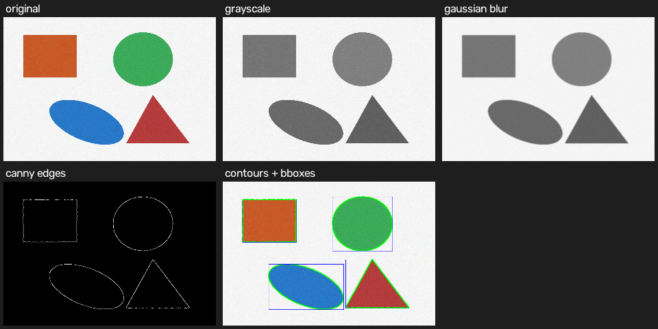

# Real-Time Object Detection and Tracking
Real-time object detection and tracking using YOLOv8, OpenCV, and ONNX Runtime.
A computer vision project using YOLOv8, OpenCV, and ONNX Runtime to detect and track people in videos, count line crossings, and evaluate inference performance.

## Features

- Person detection using YOLOv8n.
- Object tracking with unique tracking IDs.
- Line-crossing counting in both directions.
- FPS monitoring and video annotation.
- Image processing using OpenCV.
- PyTorch and ONNX Runtime latency benchmarking.

## Technologies

Python | YOLOv8 | OpenCV | NumPy | PyTorch | ONNX Runtime

## OpenCV Image Processing Demo

The pipeline demonstrates grayscale conversion, Gaussian blur, Canny edge detection, contour detection, and bounding boxes.

## Processed Video Demo

The output video demonstrates object detection, tracking IDs, FPS monitoring, and line-crossing counts.

[View the processed video](assets/output_annotated.mp4)

## Installation

pip install ultralytics opencv-python onnxruntime numpy

## Run the Project

Run the OpenCV demonstration : python opencv_basics_demo.py

Run object detection and tracking : python detect_and_track.py

Run the ONNX benchmark : python onnx_export_benchmark.py

Ensure the required input video and model dependencies are available before running the scripts.

Author

Naveenabala A

